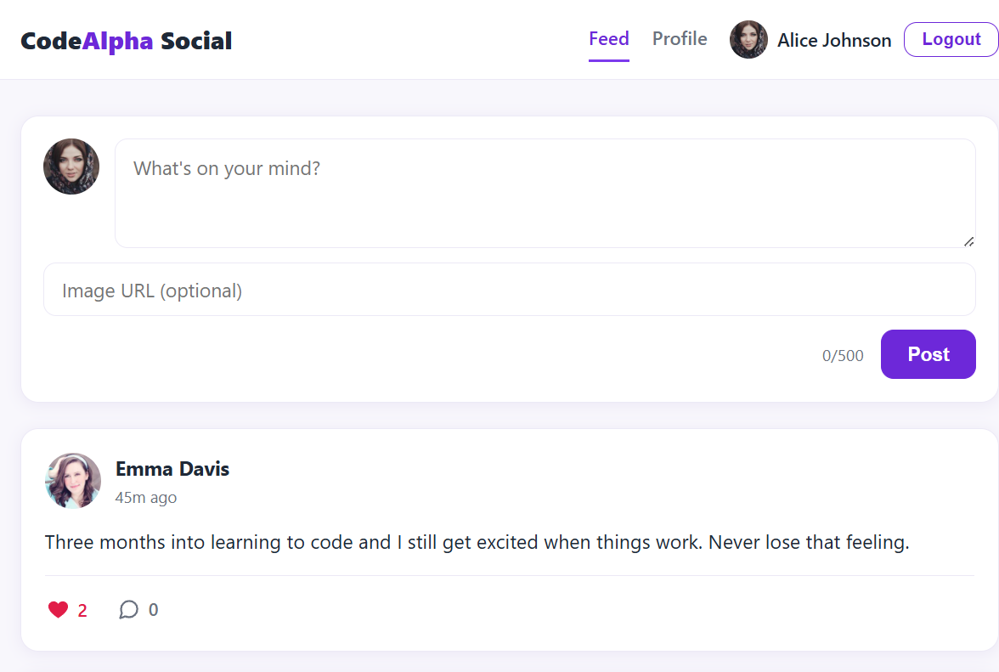
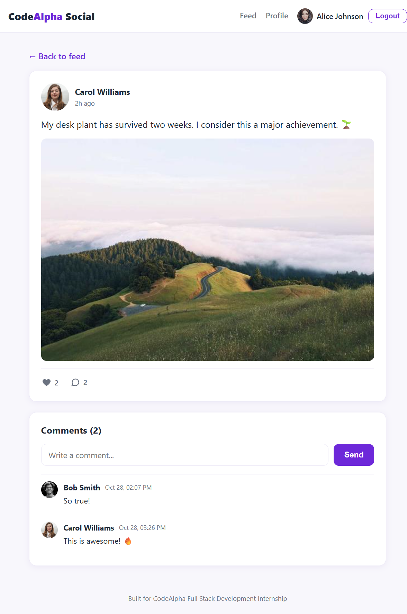
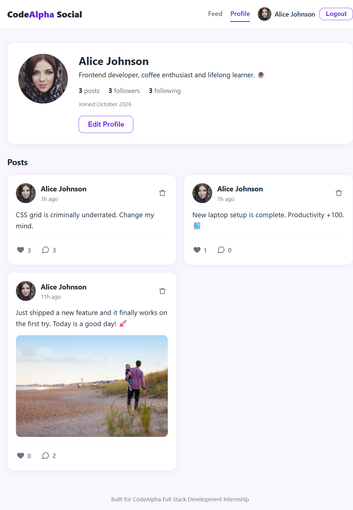
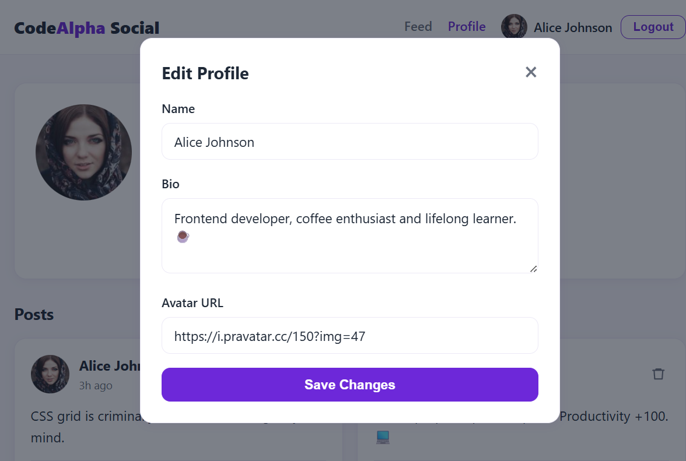
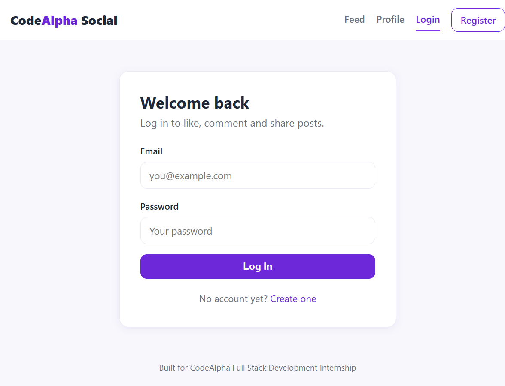
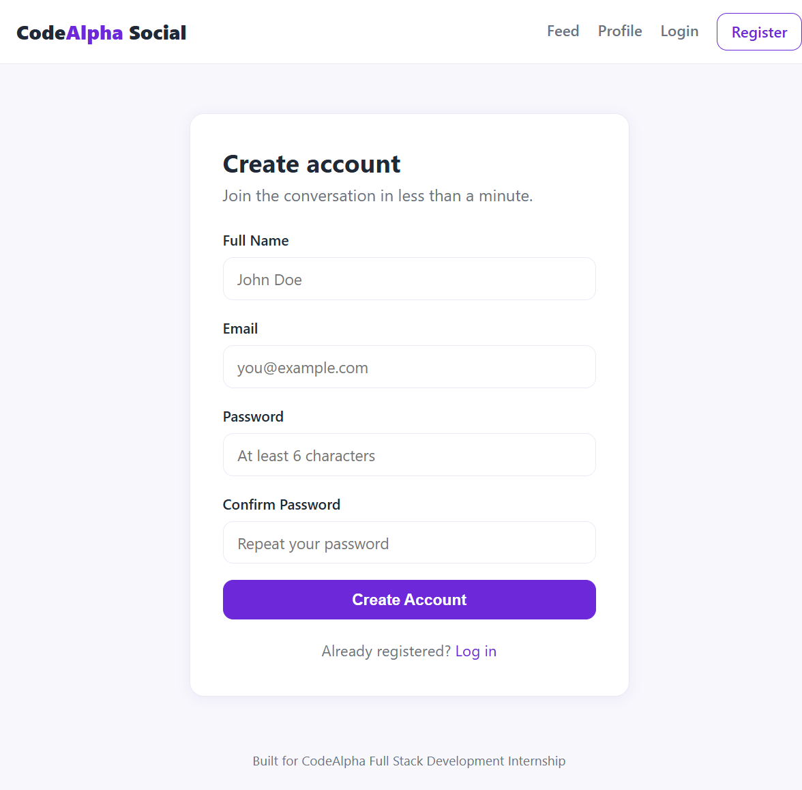

# CodeAlpha_SocialMedia

A complete full-stack social media platform built for the CodeAlpha Full Stack Development Internship. Users can register, log in, share posts, like and comment, follow each other and edit their profiles.

## Tech Stack

| Layer | Technology |
|---|---|
| Backend | Node.js, Express.js, Mongoose |
| Database | MongoDB (local by default) |
| Auth | JSON Web Tokens (JWT), bcryptjs |
| Frontend | Vanilla HTML, CSS, JavaScript (no frameworks) |
| Utilities | CORS, dotenv |

## Project Structure

```text
CodeAlpha_SocialMedia/
├── backend/
│   ├── middleware/auth.js
│   ├── models/ (User.js, Post.js)
│   ├── routes/ (auth.js, users.js, posts.js)
│   ├── .env.example
│   ├── .gitignore
│   ├── package.json
│   ├── seed.js
│   └── server.js
├── frontend/
│   ├── css/style.css
│   ├── js/ (api.js, auth.js, feed.js, profile.js, post.js)
│   ├── index.html      (feed)
│   ├── profile.html
│   ├── post.html       (single post + comments)
│   ├── login.html
│   └── register.html
├── screenshots/
├── .gitignore
└── README.md
```

## Setup Instructions

**Requirements:** Node.js 18+ and a running MongoDB instance (local or Atlas).

### 1. Open the project
```bash
cd CodeAlpha_SocialMedia
```

### 2. Install backend dependencies
```bash
cd backend
npm install
```

### 3. Configure environment variables
Copy the example file and edit it if needed:

```bash
cp .env.example .env      # Windows: copy .env.example .env
```

`backend/.env`:
```env
PORT=5001
MONGO_URI=mongodb://localhost:27017/codealpha_socialmedia
JWT_SECRET=your_super_secret_key_change_this
JWT_EXPIRES=7d
CLIENT_ORIGIN=http://localhost:5500
```

- Change `JWT_SECRET` to a strong random string for production.
- `CLIENT_ORIGIN` should match where the frontend is served. The server also accepts any `localhost` / `127.0.0.1` port during development.

### 4. Seed the database
Make sure MongoDB is running (`mongod`), then:

```bash
cd backend
npm run seed
```

This creates 5 users, 15 posts with images, random likes/comments and follow relationships.

### 5. Start the backend
```bash
npm run dev
```

The API runs at `http://localhost:5001`. Health check: `http://localhost:5001/api/health`.

> `npm run dev` uses Node's built-in `--watch` mode, so no extra dev dependency is required.

### 6. Open the frontend

The backend also serves the static frontend, so you can simply open:

```text
http://localhost:5001
```

Alternatively, serve the `frontend/` folder with the VS Code **Live Server** extension (e.g. `http://localhost:5500`) — both are supported.

## Demo Credentials

These accounts are created by the seed script. They are documented here only and are **not** shown anywhere in the UI.

| Email | Password |
|---|---|
| `user1@test.com` | `password123` |
| `user2@test.com` | `password123` |
| `user3@test.com` | `password123` |
| `user4@test.com` | `password123` |
| `user5@test.com` | `password123` |

You can also create a new account from the Register page.

## API Endpoints

### Auth (`/api/auth`)
| Method | Endpoint | Auth | Description |
|---|---|---|---|
| POST | `/register` | No | Create an account. Body: `{ name, email, password }`. Returns JWT + user. |
| POST | `/login` | No | Log in. Body: `{ email, password }`. Returns JWT + user. |
| GET | `/me` | Yes | Current user's profile. Header: `Authorization: Bearer <token>`. |

### Posts (`/api/posts`)
| Method | Endpoint | Auth | Description |
|---|---|---|---|
| GET | `/feed` | No | All posts, newest first. |
| POST | `/` | Yes | Create a post. Body: `{ content, image? }` (content max 500 chars). |
| GET | `/:id` | No | Single post with comments. |
| DELETE | `/:id` | Yes | Delete a post (author only). |
| POST | `/:id/like` | Yes | Toggle like on a post. |
| POST | `/:id/comment` | Yes | Add a comment. Body: `{ text }` (max 300 chars). |
| DELETE | `/:id/comment/:commentId` | Yes | Delete a comment (comment author only). |

### Users (`/api/users`)
| Method | Endpoint | Auth | Description |
|---|---|---|---|
| GET | `/:id` | No | Public profile info with follower/following counts. |
| GET | `/:id/posts` | No | A user's posts, newest first. |
| POST | `/:id/follow` | Yes | Toggle follow/unfollow. |
| PUT | `/profile` | Yes | Update own profile. Body: `{ name?, bio?, avatar? }`. |

## Features

1. **Feed** — all posts newest first, with avatar, name, relative time, content, optional image, like and comment counts.
2. **Create Post** — composer at the top of the feed (text + optional image URL), requires login.
3. **Post Detail** — full post, comments list and an add-comment form.
4. **Profiles** — bio, avatar, posts/followers/following counts, follow/unfollow and a posts grid.
5. **Edit Profile** — modal to update name, bio and avatar URL.
6. **Likes** — heart toggles and turns red when liked.
7. **Comments** — add comments and delete your own.
8. **Route Guards** — actions redirect to login when unauthenticated.
9. **Auth** — JWT stored in `localStorage` and sent as a Bearer token.
10. **Responsive UI** — mobile-first layout with a light theme and purple accent.

## Screenshots

Captured from the running application:

### Feed


### Single Post & Comments


### Profile


### Edit Profile


### Login


### Register


## Notes

- The backend uses CommonJS consistently; the frontend uses plain browser scripts.
- All protected endpoints expect `Authorization: Bearer <token>`.
- Public endpoints accept an optional token so they can return viewer-aware flags such as `likedByMe`, `isAuthor` and `isFollowing`.
- Post image and avatar URLs must be absolute `http(s)` URLs; text is escaped on the client before rendering.
- Never commit `backend/.env`; only `.env.example` is tracked.
- CORS allows the configured origin plus any `localhost` / `127.0.0.1` port for local development.

## License

MIT.
